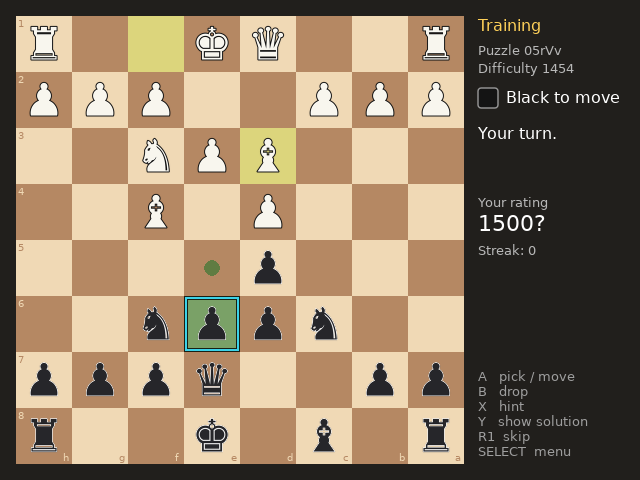

# Chessing

A chess puzzle trainer for small handheld screens, made with LÖVE 11.5.

- 38,367 puzzles from the Lichess puzzle database, in 10 difficulty levels and 19 themes
- A rating that goes up when you solve on the first try and down when you miss
- Remembers the puzzles you have already seen
- Four board looks and sound effects

## Run it

Install [LÖVE 11.5](https://love2d.org) and run `love src` from this folder.

## Layout

- `src/`: the game (Lua code, piece sprites, sounds and the puzzle list)
- `port/`: the PortMaster launch script and metadata
- `licenses/`: licenses of the game and of the third-party content

## Credits and licenses

The game code is under the MIT license (see `LICENSE`). The puzzles come from the [Lichess puzzle database](https://database.lichess.org/#puzzles), released under CC0. The piece shapes are rendered from the DejaVu Sans font. Chessing is an independent project and is not affiliated with or endorsed by Lichess.

The game code and the launch script were written with an AI assistant (Claude) and reviewed by the author.
